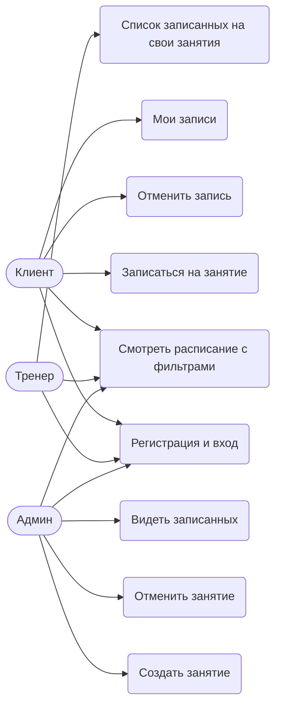
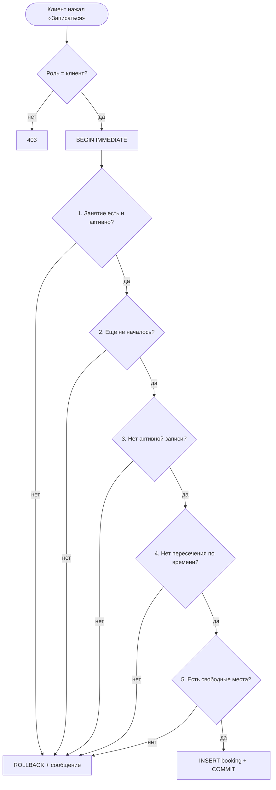
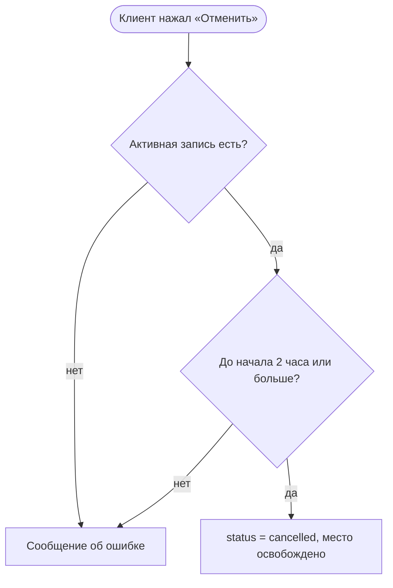
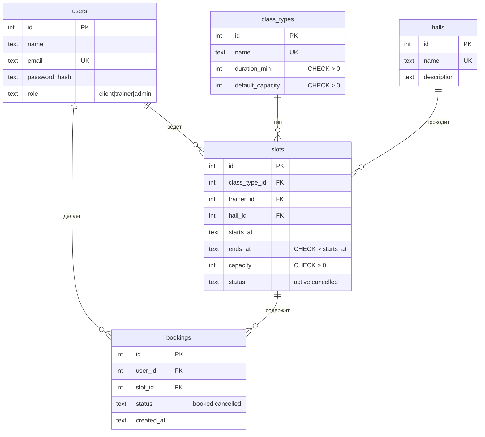
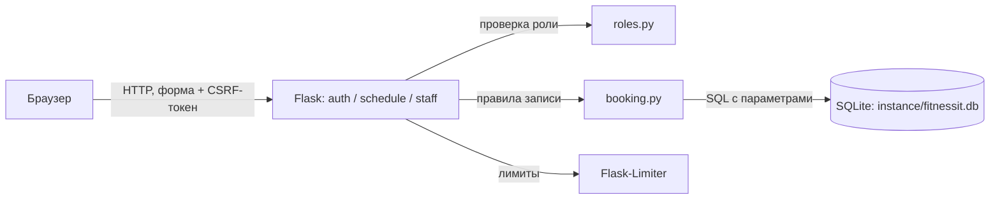

# Диаграммы

## Use Case

## Процесс бронирования

## Процесс отмены

## ER-диаграмма

Ограничение `UNIQUE(user_id, slot_id)` на `bookings`. Внешние ключи включены через `PRAGMA foreign_keys = ON`.

## Архитектура

Стек: Flask + SQLite. Пароли хранятся хешами (werkzeug). Вход не говорит, что именно неверно: email или пароль.
